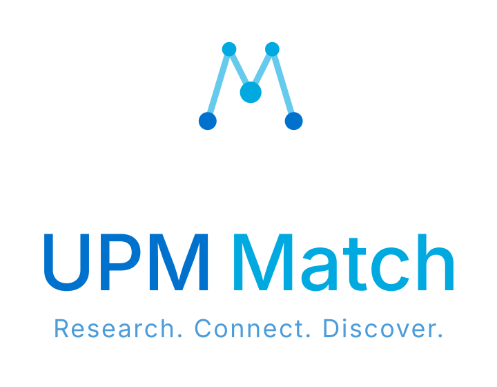

<div align="center">

<picture>
  <source media="(prefers-color-scheme: dark)"  srcset="app/static/horizontal-dark.svg">
  <source media="(prefers-color-scheme: light)" srcset="app/static/stacked.svg">
  
</picture>

<br/>

[](https://www.python.org/)
[](https://flask.palletsprojects.com/)
[](https://qdrant.tech/)
[](https://memgraph.com/)
[](https://ollama.com/)
[](https://www.docker.com/)
[](LICENSE)
[](https://doi.org/10.5281/zenodo.22259041)
[](https://innovacioneducativa.upm.es/proyectos-ie/informacion?anyo=2025-2026&id=2018)

</div>

---

UPM Match turns the public data of the **UPM Scientific Portal** into a service that can be queried in free text and that returns a ranked and justified list of potential thesis supervisors.

Choosing a supervisor is one of the most consequential decisions in a student's academic path, and it is usually made with very limited information — not because the data is missing, but because a research portal is designed to be consulted profile by profile, not to support discovery. UPM Match reframes that choice as an **information retrieval problem**: the student writes their idea in plain language, and the system answers with the researchers whose demonstrated activity is closest to it, showing the evidence behind every suggestion.

The whole system runs **on the institution's own infrastructure**, with open language models served locally. No query, profile or document leaves the university: there is no external inference service anywhere in the pipeline.

**Live prototype:** <https://wiig.dia.fi.upm.es/upm-match/>

---

## What it does

- **Supervisor recommendation** for Bachelor's (TFG) and Master's (TFM) theses, from a free-text description of the student's idea.
- **Transparent ranking**: the interface shows how the model interpreted the query (extracted terms, reformulated query) and the evidence supporting each recommendation.
- **Profile exploration** as an alternative to the ranked list, so the recommendation never becomes the only path.
- **Two-stage retrieval**: lexical and dense retrieval with rank fusion, followed by an optional listwise re-ranking grounded in the knowledge graph.

## How it works

1. **Acquisition** — an incremental, respectful crawl of the public Scientific Portal, keeping the raw source immutable and traceable.
2. **Knowledge graph** — the public activity is structured into a graph of ~172 600 nodes and ~268 900 relations (researchers, publications, projects, supervised works, teaching) in Memgraph.
3. **Semantic profiling** — for each researcher, normalised topics, expertise domains and an automatically written research biography, generated year by year with open LLMs served by Ollama and weighted towards recent activity.
4. **Indexing** — each profile is indexed both sparsely (BM42) and densely in Qdrant, fused with RRF at query time.
5. **Serving** — a Flask application resolves the student's idea into a query, retrieves, optionally re-ranks with graph evidence, and presents the result with its justification.

The pipeline is orchestrated with Airflow (see [`infra/`](infra/)) and is fully re-runnable: every phase is idempotent and picks up where the previous one left off.

## Repository layout

```
01_find_ids.py … 08_manage_exclusions.py   Pipeline phases, in execution order
app/                                       Flask web application (search, profiles, legal notice, survey)
dbs/                                       Database modules: Memgraph, Qdrant, MinIO
models/                                    Pydantic schemas shared across phases
evaluation/                                Evaluation harness — see evaluation/README.md
infra/                                     Docker Compose stack + Airflow DAGs — see infra/README.md
utils/                                     Shared helpers (exclusion list, researcher loading, …)
tests/                                     Test suite
```

## Getting started

Requires Docker and [uv](https://docs.astral.sh/uv/).

```bash
cp .env.sample .env
```

Fill in the required values (every variable is documented inline in [`.env.sample`](.env.sample)), then bring the stack up:

```bash
docker compose -f infra/docker-compose.yaml up -d
```

The full deployment model — single-subpath routing, reverse proxy, service layout — is documented in [`infra/README.md`](infra/README.md).

## Reproducing the evaluation

The evaluation needs no manual labelling: every already-supervised work acts as a query whose correct answer is its actual supervisor. Five retrieval strategies plus a second-stage re-ranker are compared over a reference set of 500 real works (250 TFG + 250 TFM), with three repetitions and paired significance tests.

The reference set itself is **not distributed** (see below), but it is **deterministic and regenerable**:

```bash
uv run evaluation/build_gold_standard.py
```

Given the same corpus, this reproduces exactly the same 500 records — the selection is an explicit, ordered criterion, not a random sample. The full procedure, the metrics and the analysis pipeline are documented in [`evaluation/README.md`](evaluation/README.md).

## Data availability

| Material | Where | Licence |
|---|---|---|
| Source code (this repository) | [10.5281/zenodo.22259041](https://doi.org/10.5281/zenodo.22259041) | Apache 2.0 |
| Aggregated results of the evaluation | [10.5281/zenodo.YYYYYYY](https://doi.org/10.5281/zenodo.YYYYYYY) | CC BY 4.0 |
| Reference set of 500 works | **Not published** | — |

The two deposits are separate because the archive assigns a single licence per record and code and results do not share one.

**Why the reference set is not published.** Although the supervisor is pseudonymised, each record keeps the literal title and abstract of the work, which resolve on the portal itself to the person who supervised it — so pseudonymisation does not make the set anonymous, and those abstracts cannot be stripped without destroying the set, since they *are* the queries. Those abstracts are moreover authored by the students who wrote the works. Reproducibility is preserved through the procedure rather than through the data: the generator above is part of this deposit.

## Privacy, rights and exclusion

UPM Match processes public professional information about identified researchers, and it profiles them. The legal basis is the university's public-interest mission, not consent. The deployed application publishes a legal notice identifying the controller, the purpose, the basis, the origin and the categories of data, warns explicitly that the biographies are written by a language model and may contain errors, and offers a visible channel for correction and opt-out.

Opt-out is enforced technically in two places at once: at the entry point of the pipeline, so an excluded researcher stops being crawled, enriched and indexed, and at runtime in the application, so the exclusion takes effect immediately without waiting for the next regeneration. See [`08_manage_exclusions.py`](08_manage_exclusions.py) and [`utils/exclusions.py`](utils/exclusions.py).

Requests concerning a researcher's profile should be addressed to the contact published on the application's legal page.

## Citing

If you use this software, please cite it through [`CITATION.cff`](CITATION.cff), or:

> Boleas Francisco, Y., & Badenes Olmedo, C. (2026). *UPM Match: recomendación de tutores académicos mediante representación semántica de la actividad investigadora* (v1.0.0). Zenodo. https://doi.org/10.5281/zenodo.22259041

The accompanying Master's thesis (Máster Universitario en Aprendizaje Automático y Datos Masivos, ETSISI–UPM, 2026) documents the design decisions, the evaluation protocol and the ethical and legal analysis in full.

## Project context

<table><tr>
<td>

Developed as part of the **Educational Innovation Project IE26.6102**, funded by Universidad Politécnica de Madrid, which explores how artificial intelligence can support academic decision-making and collaboration within universities.

One of that project's stated goals is to **balance the distribution of supervision load**, which is why the system deliberately excludes impact metrics and popularity signals from its ranking and reports its quality broken down by supervisor productivity.

</td>
<td align="center" valign="middle" width="180">

<a href="https://www.etsisi.upm.es"></a>&nbsp;&nbsp;<a href="https://www.upm.es"></a>

</td>
</tr></table>

## Licence

Apache License 2.0 — see [`LICENSE`](LICENSE).
